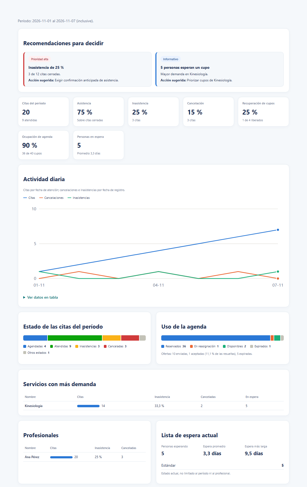

# Reportería para la toma de decisiones — Evidencia F3

**Origen:** reunión de coordinación del 19/11/2026: «Mostrar reportería (dashboard, con información de todo el proyecto), es importante que ayude a tomar decisiones».
**Implementación:** PR #257 (merge `6124678`, 24/11/2026).

## 1. Qué se entregó

| Componente | Detalle |
| --- | --- |
| API | `GET /api/v1/reports/dashboard`. Usa el permiso `reports.read` y el contexto institucional, y valida la query igual que `/reports/indicators`. |
| Desktop | Análisis → **Panel de gestión**, ubicado antes de Reportes y Auditoría. |
| Alcance de datos | Toda la operación de la institución (o de la sede del contexto): citas y sus estados, cupos de agenda, cupos liberados y recuperados, ofertas de reasignación, lista de espera y prioridades. Se puede filtrar por sede, servicio y profesional. |
| Período | Períodos rápidos de 7, 30 y 90 días y mes en curso, o un rango de 1 a 366 días. Es diario hasta 62 días y semanal (ISO) en períodos mayores. |



> **Captura con datos de ejemplo** de las pruebas automatizadas Desktop (`apps/desktop/test/fixtures/dashboard.mjs`), renderizada con los componentes y estilos reales. No representa operación real de una institución. En la presentación se muestra con los datos del entorno DEMO.

## 2. Cómo ayuda a decidir

El panel se lee de arriba hacia abajo: primero **qué hacer** y después **por qué**.

| Sección | Pregunta que responde | Decisión que habilita |
| --- | --- | --- |
| Recomendaciones | ¿Qué requiere atención ahora? | Acción sugerida con prioridad alta, media o informativa, escrita en texto. |
| Indicadores clave | ¿Cómo está la operación en el período? | Comparar asistencia, inasistencia, cancelación, recuperación y ocupación entre períodos o sedes. |
| Actividad diaria/semanal | ¿Cuándo ocurren las cancelaciones e inasistencias? | Detectar días o semanas críticas para reforzar recordatorios. |
| Estado de las citas / Uso de la agenda | ¿Cuánta capacidad se usa o se pierde? | Abrir o cerrar bloques de agenda. |
| Servicios con más demanda | ¿Dónde falta capacidad? | Priorizar cupos del servicio con más personas esperando y más inasistencia. |
| Profesionales | ¿Cómo se distribuye la carga? | Redistribuir agenda entre profesionales. |
| Lista de espera actual | ¿Cuánto espera la gente y con qué prioridad? | Ajustar la política de reasignación. |

Las recomendaciones salen de reglas con umbrales y muestras mínimas fijas (`apps/api/src/reports/reports-dashboard.insights.ts`). Si no hay datos suficientes, el panel no emite alertas. El detalle está en la [guía de defensa](../../../Evidencias%20Grupales/Guia_Preguntas_Defensa_Fase3.md#5-reportería-para-la-toma-de-decisiones-panel-de-gestión).

## 3. Garantías técnicas

- **Mismo alcance que Reportes.** Un CTE compartido hace que los totales del panel y de `/reports/indicators` coincidan; lo comprueba una prueba E2E.
- **Lectura consistente.** Las 8 consultas corren en una transacción `RepeatableRead`, con SQL parametrizado y fechas en la zona horaria de la institución.
- **Aislamiento.** Datos de otra institución o de una sede fuera del contexto responden `404`. El panel no expone correos, RUT ni datos personales de pacientes.
- **Accesibilidad.** La severidad se escribe en texto, cada gráfico tiene leyenda, texto alternativo y tabla de datos, y la paleta es apta para daltonismo.

## 4. Métricas del proyecto completo (corte 24/11/2026)

| Indicador | Valor |
| --- | ---: |
| Pull Requests fusionadas | 113 |
| Commits en `main` | 256 |
| Endpoints HTTP de la API propia | 75 |
| Módulos backend | 19 |
| Tablas de negocio en PostgreSQL | 44 |
| Migraciones aplicadas | 14 |
| Pruebas unitarias API | 1107/1107 |
| Pruebas Web | 172/172 |
| Pruebas Desktop | 236/236 |
| Pruebas `client-core` | 6/6 |
| Suites E2E sobre PostgreSQL real | 24 |
| Integraciones externas en uso | Google OAuth/OIDC, Google Calendar, Resend, Nager.Date, OpenStreetMap + Google Maps URLs |

**Cómo se obtuvieron los valores:**

- Pull Requests: `gh pr list --state merged`.
- Commits: `git rev-list --count HEAD`.
- Endpoints: decoradores `@Get/@Post/@Patch/@Put/@Delete` de los controladores.
- Tablas y migraciones: base E2E PostgreSQL 18.7 (ver `CONTROL_DE_CAMBIOS_F3.md`).
- Pruebas: `npm test` de cada workspace.
- Suites E2E: scripts `test:e2e:*` de `apps/api/package.json`.

## 5. Cómo reproducir

```powershell
# Pruebas del panel (unitarias API y Desktop)
npm run build -w @citajusta/api
node --test apps/api/test/reports-dashboard.test.mjs apps/api/test/reports-dashboard.insights.test.mjs
npm test -w @citajusta/desktop

# E2E sobre PostgreSQL Docker aislado (ver docs/development/SETUP.md)
npm run test:e2e:reports -w @citajusta/api
```
